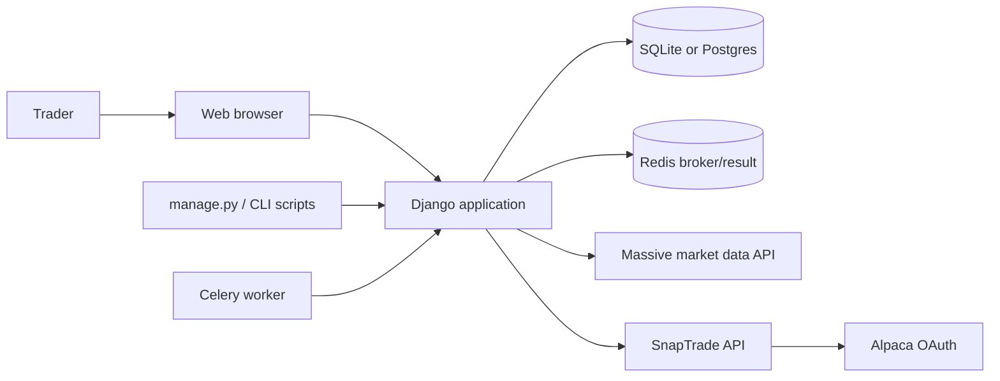
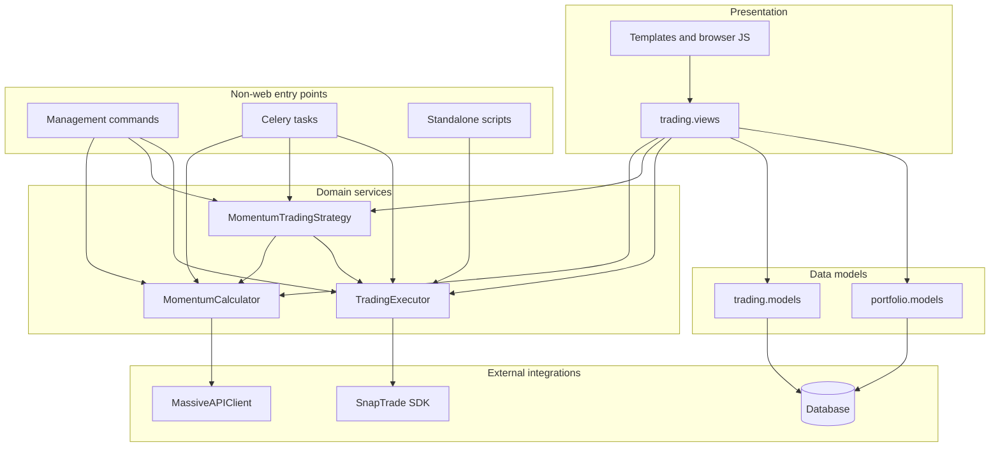
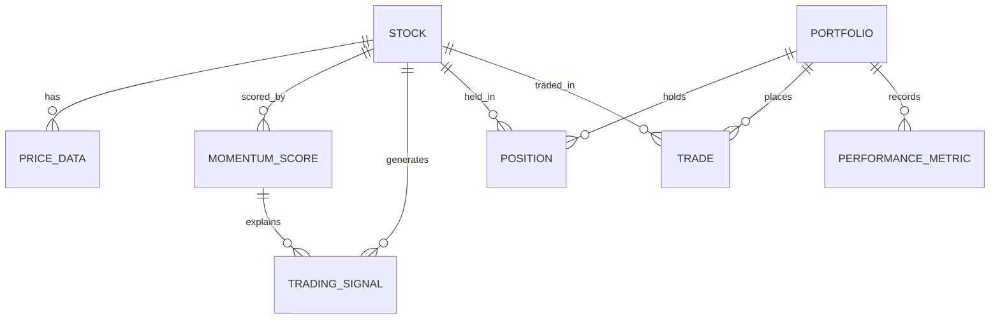
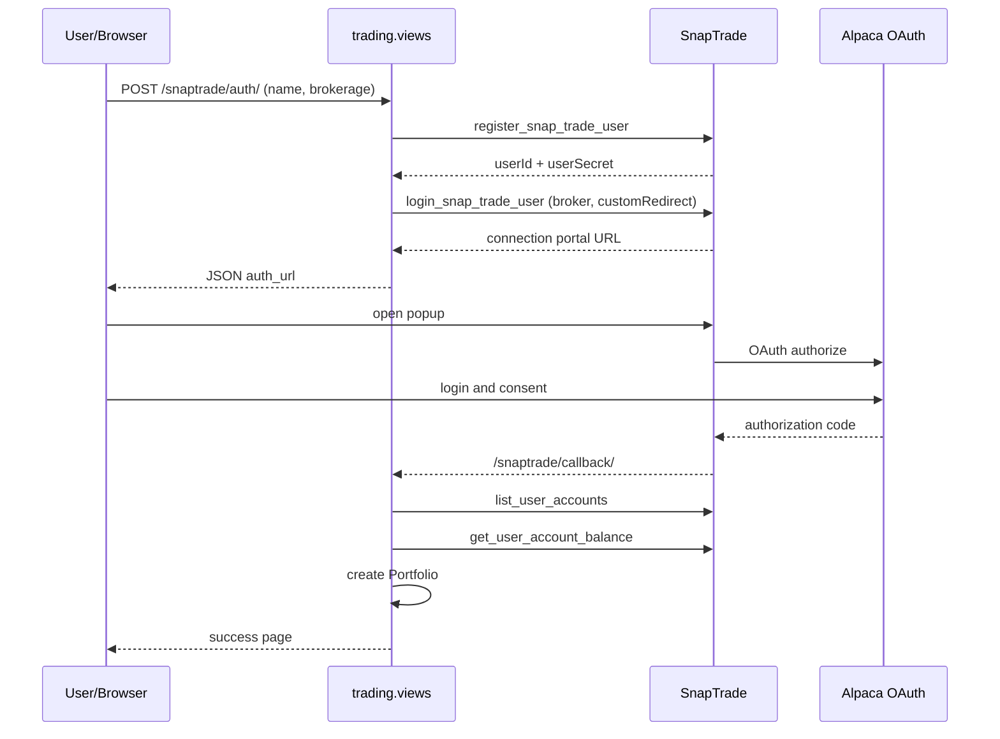
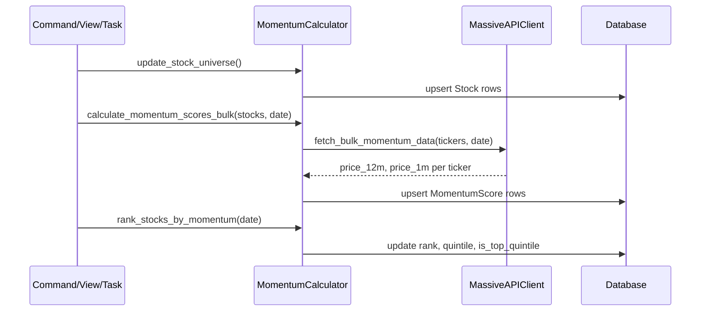
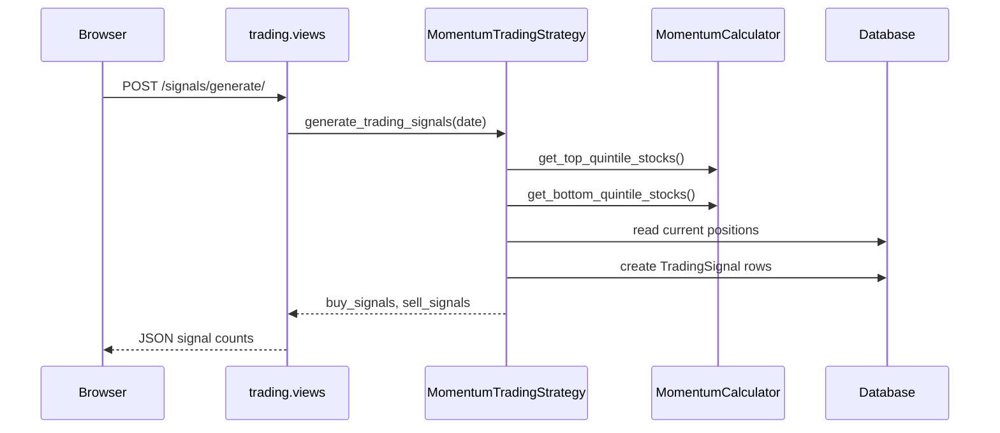
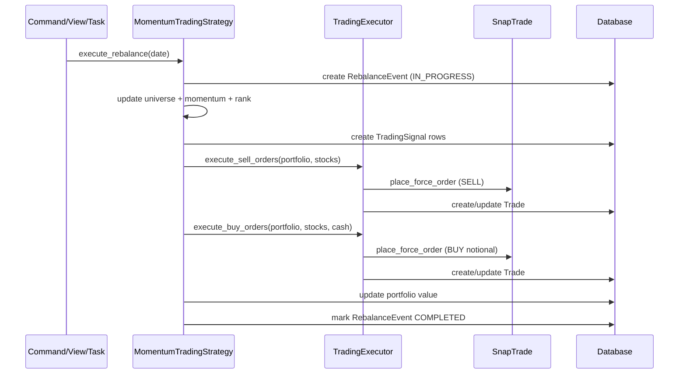
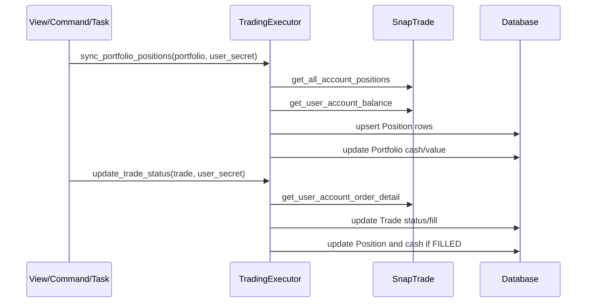

# Project 1 - Momentum Trading System Architecture

This document explains how the pieces of `project1` connect: the Django apps, models,
services, web views, Celery tasks, management commands, and external APIs. It is meant as
a map for understanding and for planning the future merge with `project2` and `project3`.

Unless noted otherwise, file paths in this document are relative to the `project1/`
directory, which is planned to become the repository root.

## 30-second summary

Project 1 is a Django monolith with two apps and a service layer.

- `trading` owns market data, momentum calculation, strategy/signals, broker execution,
  the web UI, Celery tasks, and management commands.
- `portfolio` owns persistent portfolio state: `Portfolio`, `Position`, `Trade`, and
  `PerformanceMetric`. It currently has no active views or URLs.
- `trading/services/` contains the integration and business-logic layer.
- External services: Massive (market data), SnapTrade + Alpaca OAuth (broker), Redis
  (Celery), and SQLite/Postgres (database).

```text
Browser (templates + JS)
        |
        v
trading.views ---------------------> portfolio.models (Portfolio/Position/Trade)
        |                                        ^
        +--> MomentumCalculator -----------------+--> Massive API
        +--> MomentumTradingStrategy ------------+--> TradingExecutor --> SnapTrade API
        +--> Celery tasks / management commands
```

## 1. System context



| Actor / system | Role |
| --- | --- |
| Trader | Uses the web dashboard or CLI to run momentum and trade workflows. |
| Django app | Owns all state, rendering, orchestration, and integrations. |
| Massive | Supplies historical prices and bulk daily aggregates. |
| SnapTrade | Connects broker accounts and forwards orders to Alpaca. |
| Alpaca | Performs the actual OAuth login and paper/live brokerage operations. |
| Redis | Celery broker and result backend. |

## 2. Component and layer map



### Layer responsibilities

| Layer | Files | Responsibility |
| --- | --- | --- |
| Project shell | `momentum_trader/settings.py`, `urls.py`, `celery.py`, `wsgi.py`, `asgi.py` | Configuration, root URL routing, Celery wiring. |
| Models | `trading/models.py`, `portfolio/models.py` | Persisted domain state and small model helpers. |
| Services | `trading/services/massive_client.py`, `momentum_calculator.py`, `strategy_engine.py`, `snaptrade_client.py` | External API calls, momentum math, strategy decisions, order execution. |
| Web | `trading/views.py`, `trading/templates/trading/*.html` | Page rendering, JSON endpoints, SnapTrade OAuth flow. |
| Async | `trading/tasks.py` | Celery jobs for momentum, rebalance, sync, and backfill. |
| CLI | `trading/management/commands/*.py`, `sync_portfolio.py` | Batch operations and one-off maintenance. |

`portfolio/views.py` and `portfolio/urls.py` are placeholders; the UI lives in `trading`.

## 3. Data model



`REBALANCE_EVENT` is an audit log with no foreign keys to signals. A rebalance event is
created, populated with counts, and marked completed; the signals it generated are linked
only through the shared calculation date.

### Model guide

| Model | File | Purpose |
| --- | --- | --- |
| `Stock` | `trading/models.py:8` | Tradable symbol and universe membership. |
| `PriceData` | `trading/models.py:58` | Daily OHLCV history; unique per stock/date. |
| `MomentumScore` | `trading/models.py:82` | Calculated momentum, rank, quintile, top-quintile flag. |
| `TradingSignal` | `trading/models.py:128` | BUY/SELL/HOLD intent with target value/quantity. |
| `RebalanceEvent` | `trading/models.py:158` | Audit record for a rebalance run and its status. |
| `Portfolio` | `portfolio/models.py:7` | Cash, total value, and SnapTrade identity/secret. |
| `Position` | `portfolio/models.py:38` | Current holdings, cost basis, and unrealized P&L. |
| `Trade` | `portfolio/models.py:97` | Order record, broker order id, fill state. |
| `PerformanceMetric` | `portfolio/models.py:171` | Daily portfolio value/return snapshot. |

Important relationships:

- `Stock` is the shared anchor for market data, signals, positions, and trades.
- `TradingSignal.momentum_score` is a nullable foreign key to the score that justified it.
- `Portfolio` stores SnapTrade information directly in `snaptrade_user_id`,
  `snaptrade_account_id`, and `snaptrade_user_secret` (`portfolio/models.py:13-15`).
- `Position` and `Trade` both join `Portfolio` and `Stock`.

## 4. End-to-end flows

### 4.1 Broker connection and portfolio creation

1. The user fills `create_portfolio.html` (name, description, brokerage) and clicks
   Connect.
2. Browser JS posts to `/snaptrade/auth/`, handled by `initiate_snaptrade_auth`
   (`trading/views.py:241`).
3. The view creates a SnapTrade client, registers a SnapTrade user, and stores the
   generated `userId`, `userSecret`, and portfolio form data in the Django session.
4. The view calls `login_snap_trade_user` with the selected broker and a custom redirect
   URL, and returns the SnapTrade connection portal URL.
5. Browser JS opens the portal in a popup. SnapTrade redirects the user to Alpaca's OAuth
   page, where the user logs in and grants access.
6. SnapTrade redirects back to `/snaptrade/callback/`, handled by `snaptrade_callback`
   (`trading/views.py:328`).
7. The callback reads session data, lists the user's SnapTrade accounts, reads the balance,
   and creates the `Portfolio` (`trading/views.py:396`). There is no separate portfolio
   creation endpoint; creation is a side effect of a successful callback.



Relevant code:

- Form and JS: `trading/templates/trading/create_portfolio.html`
- Auth start: `trading/views.py:241`
- Callback and portfolio creation: `trading/views.py:328`
- SnapTrade execution wrapper: `trading/services/snaptrade_client.py`

### 4.2 Market data ingestion and momentum scoring

1. Universe setup uses `MomentumCalculator.update_stock_universe()`
   (`trading/services/momentum_calculator.py:247`), which reads a hardcoded S&P 500 subset
   from `MassiveAPIClient.get_sp500_tickers()` and upserts `Stock` rows.
2. Historical backfill uses `MomentumCalculator.backfill_price_data()`
   (`momentum_calculator.py:264`) and `MassiveAPIClient.fetch_stock_data()`
   (`massive_client.py:42`) to write `PriceData` rows.
3. Bulk scoring uses `MomentumCalculator.calculate_momentum_scores_bulk()`
   (`momentum_calculator.py:87`). It calls `MassiveAPIClient.fetch_bulk_momentum_data()`
   (`massive_client.py:160`), which fetches grouped daily aggregates for the 12-month and
   1-month dates in about two API calls, with an individual-call fallback.
4. Momentum is `(price_1m_ago - price_12m_ago) / price_12m_ago`, stored as
   `MomentumScore.momentum_score`.
5. Ranking calls `rank_stocks_by_momentum()` (`momentum_calculator.py:204`), which delegates
   to `MomentumScore.calculate_quintiles_for_date()` (`trading/models.py:106`) to set
   `rank`, `quintile`, and `is_top_quintile`.



Entry points that trigger this flow:

- Web: `recalculate_momentum` (`trading/views.py:697`)
- CLI: `manage.py update_momentum_scores` and `manage.py backfill_data`
- Celery: `calculate_momentum_scores_task`, `daily_momentum_update`,
  `backfill_price_data_task` (`trading/tasks.py`)

### 4.3 Signal generation

1. The UI calls `/signals/generate/`, handled by `generate_signals`
   (`trading/views.py:603`).
2. The view picks the **first active portfolio** (`trading/views.py:621`).
3. `MomentumTradingStrategy.generate_trading_signals()` (`strategy_engine.py:89`) does:
   - Load current holdings from `Portfolio.get_current_positions()`.
   - Select top-quintile stocks as BUY candidates not already held.
   - Select bottom-quintile held stocks as SELL candidates.
   - Compute available cash as `current_cash * 0.95` via
     `TradingExecutor.get_available_cash_for_trading()` (`snaptrade_client.py:292`).
   - Split available cash equally across buy candidates.
   - Create `TradingSignal` rows with target value/quantity and a reason.
4. No orders are placed in this step.



### 4.4 Rebalance and order execution

There are three execution paths:

1. **Full rebalance** via `execute_rebalance` command or the scheduled Celery task:
   `MomentumTradingStrategy.execute_rebalance()` (`strategy_engine.py:40`) updates the
   universe, calculates and ranks momentum, generates signals, executes sells first and
   then buys, updates portfolio totals, and marks the `RebalanceEvent` complete.
2. **Single signal execution** via `/signal/<id>/execute/`:
   `execute_signal_trade` (`trading/views.py:521`) calls `TradingExecutor.execute_buy_orders`
   or `execute_sell_orders` with the portfolio's stored SnapTrade secret.
3. **Manual trade** via `/portfolio/<id>/trade/`: `execute_trade`
   (`trading/views.py:429`) only creates a PENDING `Trade` in the database. It does not
   call SnapTrade.

`TradingExecutor.execute_buy_orders()` (`snaptrade_client.py:100`) creates a `Trade`, places
a notional market order through SnapTrade, stores the broker order id, and marks the trade
SUBMITTED. `execute_sell_orders()` (`snaptrade_client.py:158`) does the same using share
units from the current position.



### 4.5 Portfolio and trade synchronization

- Web: `/portfolio/<id>/sync/` -> `sync_portfolio` (`trading/views.py:731`).
- CLI: `manage.py sync_portfolio --portfolio <name> [--update-trades]`.
- Celery: `sync_portfolio_task` (`trading/tasks.py:90`).
- Standalone: `python sync_portfolio.py [portfolio_id]`.

`TradingExecutor.sync_portfolio_positions()` (`snaptrade_client.py:24`) reads SnapTrade
positions and balance, upserts `Position` rows, and updates `Portfolio.current_cash` and
`total_value`. `TradingExecutor.update_trade_status()` (`snaptrade_client.py:224`) fetches a
single order, maps SnapTrade statuses to local `Trade.status` values, updates fill details,
and calls `Trade.update_position()` when the trade becomes FILLED.



## 5. Entry point matrix

| Entry point | Trigger | Main code |
| --- | --- | --- |
| Dashboard | Browser | `trading/views.py:19` |
| Portfolio detail | Browser | `trading/views.py:57` |
| Momentum scores page | Browser | `trading/views.py:87` |
| Trading signals page | Browser | `trading/views.py:119` |
| Portfolio list/create/delete | Browser | `trading/views.py:189`, `:200`, `:209` |
| SnapTrade auth start | Browser fetch | `trading/views.py:241` |
| SnapTrade callback | SnapTrade redirect | `trading/views.py:328` |
| Manual trade | Browser fetch | `trading/views.py:429` (DB only) |
| Execute one signal | Browser fetch | `trading/views.py:521` |
| Generate signals | Browser fetch | `trading/views.py:603` |
| Delete pending signals | Browser fetch | `trading/views.py:653` |
| Recalculate momentum | Browser fetch | `trading/views.py:697` |
| Sync portfolio | Browser fetch | `trading/views.py:731` |
| Momentum/performance/portfolio APIs | Browser charts | `trading/views.py:141`, `:166`, `:679` |
| Backfill prices | CLI | `trading/management/commands/backfill_data.py` |
| Update momentum | CLI | `trading/management/commands/update_momentum_scores.py` |
| Execute rebalance | CLI | `trading/management/commands/execute_rebalance.py` |
| Sync portfolio | CLI | `trading/management/commands/sync_portfolio.py` |
| Flush demo data | CLI | `trading/management/commands/flush_demo_data.py` |
| Momentum/rebalance/sync/backfill jobs | Celery | `trading/tasks.py:14`, `:56`, `:90`, `:118`, `:141`, `:159` |
| Legacy sync script | CLI | `sync_portfolio.py` |

## 6. File-by-file map

| File | What it does |
| --- | --- |
| `momentum_trader/settings.py` | Installs apps, loads `.env` values with `python-decouple`, configures DB, Celery, and strategy constants (`:128-145`). |
| `momentum_trader/urls.py` | Mounts `trading.urls` at `/` and `portfolio.urls` at `/portfolio/` (the latter is empty). |
| `momentum_trader/celery.py` | Creates the Celery app and auto-discovers tasks. |
| `trading/models.py` | `Stock`, `PriceData`, `MomentumScore`, `TradingSignal`, `RebalanceEvent`. |
| `trading/services/massive_client.py` | Massive REST client, rate limiting, cache, bulk grouped-daily fetch, price-on-date lookup. |
| `trading/services/momentum_calculator.py` | Universe management, backfill, bulk/individual scoring, ranking, quintiles, statistics. |
| `trading/services/strategy_engine.py` | Rebalance decision, signal generation, signal execution, performance summary, setup validation, backtest placeholder. |
| `trading/services/snaptrade_client.py` | SnapTrade client, position/balance sync, buy/sell orders, trade status updates. |
| `trading/views.py` | All page and JSON endpoints, including the SnapTrade OAuth start/callback. |
| `trading/tasks.py` | Celery wrappers around momentum, rebalance, sync, and backfill. |
| `trading/management/commands/*.py` | Operational CLI commands. |
| `trading/templates/trading/*.html` | Server-rendered dashboard, portfolios, signals, momentum, and success pages; browser JS calls the JSON endpoints. |
| `portfolio/models.py` | `Portfolio`, `Position`, `Trade`, `PerformanceMetric` and their business helpers. |
| `portfolio/admin.py` | Django admin registration for portfolio models. |
| `portfolio/views.py`, `portfolio/urls.py` | Placeholders; no active routes. |
| `sync_portfolio.py` | Standalone script that duplicates the sync command outside `manage.py`. |

## 7. Dependency and coupling notes

- `portfolio/models.py` imports `trading.models.Stock`, so `portfolio` depends on `trading`
  at the model layer.
- `trading.services.strategy_engine` and `trading.services.snaptrade_client` import
  `portfolio.models`, so `trading` depends on `portfolio` in the service layer. The apps are
  effectively coupled in both directions.
- Services are created through factory functions: `get_massive_client()`,
  `get_momentum_calculator()`, `get_strategy_engine(portfolio)`, and
  `get_trading_executor()`.
- Configuration flows from `.env` through `python-decouple` into `settings`.
- The SnapTrade user secret is stored in the `Portfolio` row and passed explicitly to
  executor methods; it is not held in a separate credential model.

## 8. Known gaps and risks

These describe current behavior, not necessarily desired behavior. They matter for the
future merge because they can hide bugs or create duplicated concepts.

1. **Signal generation ignores the selected portfolio.** `generate_signals` always uses the
   first active portfolio (`trading/views.py:621`).
2. **`sync_portfolio_task` is missing `user_secret`.** It calls
   `sync_portfolio_positions(portfolio)` (`trading/tasks.py:101`), but the method requires a
   secret (`snaptrade_client.py:26-27`), so the task fails.
3. **Manual trades do not execute at the broker.** `execute_trade` only creates a PENDING
   `Trade` (`trading/views.py:429`); only `execute_signal_trade` and the rebalance path call
   SnapTrade.
4. **`PerformanceMetric` is never written.** It is read by the performance API and strategy
   summary but no code creates rows, so performance charts remain empty.
5. **Strategy constants are not fully honored.** `MOMENTUM_LOOKBACK_MONTHS` and
   `MOMENTUM_SKIP_MONTHS` are read into `MomentumCalculator` but calculations hardcode
   365/30-day offsets. `TOP_QUINTILE_THRESHOLD` is unused.
6. **No Celery beat schedule is configured.** Tasks are defined, and `django_celery_beat` is
   installed, but settings contain no `CELERY_BEAT_SCHEDULE` or periodic task setup.
7. **Duplicate sync entry points.** `sync_portfolio.py` at the repo root duplicates the
   `manage.py sync_portfolio` command.
8. **Unused backup file.** `trading/views.py.bak` is not wired to anything.
9. **The `portfolio` app is model/admin only.** Its views and URLs are placeholders.
10. **Broker choice is effectively hardcoded.** `initiate_snaptrade_auth` maps `ALPACA` to
    `ALPACA-PAPER` (`trading/views.py:294-298`); the UI offers only one brokerage.
11. **The SnapTrade user secret is stored in plain text** on `Portfolio`
    (`portfolio/models.py:15`). Consider encryption or a dedicated secret store in the
    unified system.
12. **Session dependence in the OAuth flow.** If the Django session is lost or expires
    between auth start and callback, the callback cannot create the portfolio
    (`trading/views.py:330-339`).

## 9. Future merge notes (placeholder)

`project2` (50/200 moving-average index strategy) and `project3` (covered-call CLI) will get
their own architecture documents in this `docs/` folder. When merged, the likely overlap
areas are:

- Market data clients (Massive in projects 1 and 2; Polygon in project 3).
- SnapTrade execution and position syncing (projects 1, 2, and 3).
- `TradingSignal`, `Trade`, and `Portfolio` models (projects 1 and 2).
- Separate strategy engines that should become pluggable strategies under one orchestration
  layer.
- Project 3's options/covered-call workflow, which has no equivalent in project 1 yet.

## 10. Glossary

| Term | Meaning |
| --- | --- |
| Universe | The set of `Stock` rows eligible for scoring and trading. |
| Quintile | One of five rank buckets; quintile 1 is the top 20 percent. |
| Signal | A BUY/SELL intent stored in `TradingSignal`, not yet an order. |
| Rebalance | The full workflow of rescoring, generating signals, and placing orders. |
| Sync | Pulling positions and balances from SnapTrade into local models. |
| Notional order | A buy order sized by dollar amount rather than share count. |
