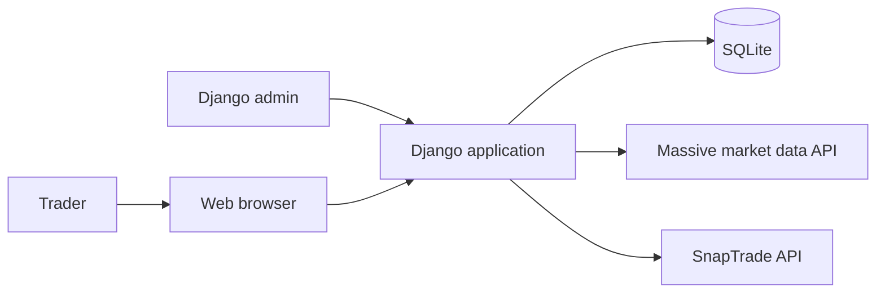
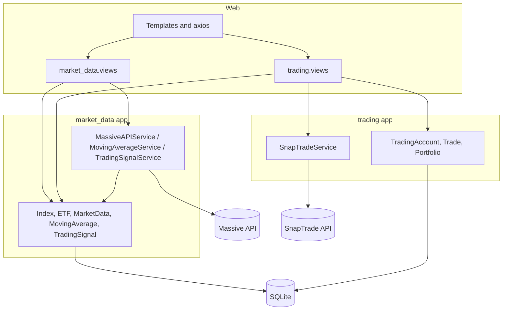
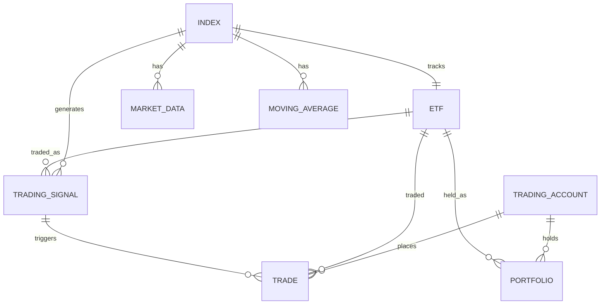
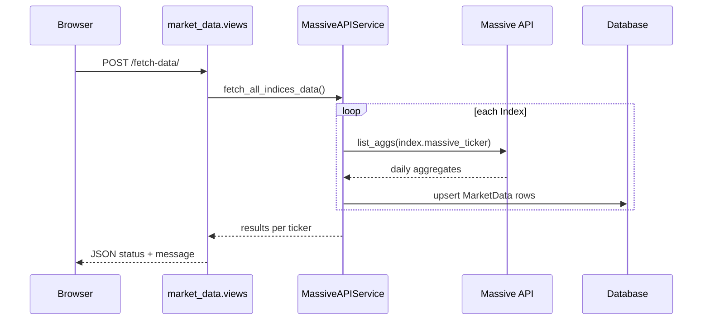
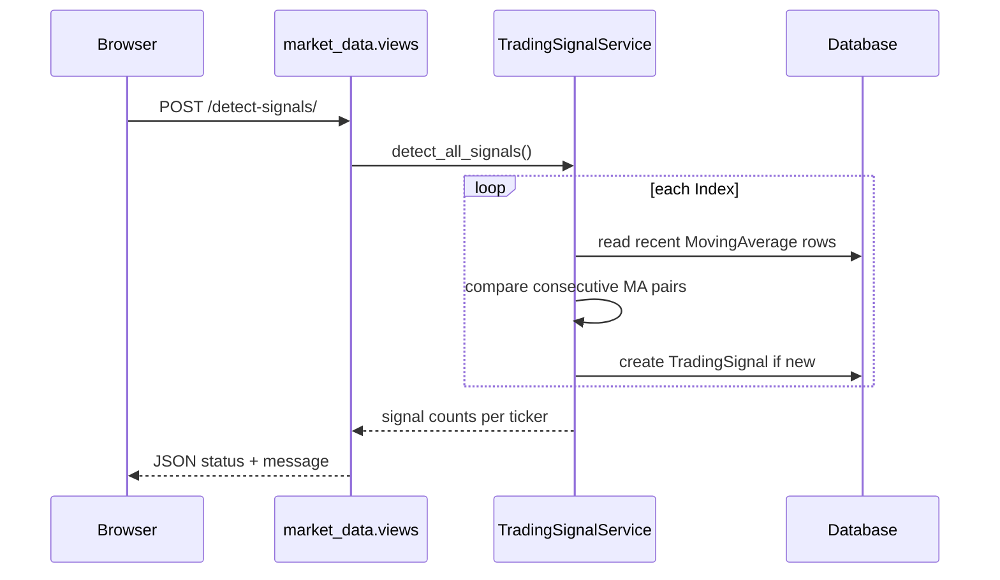
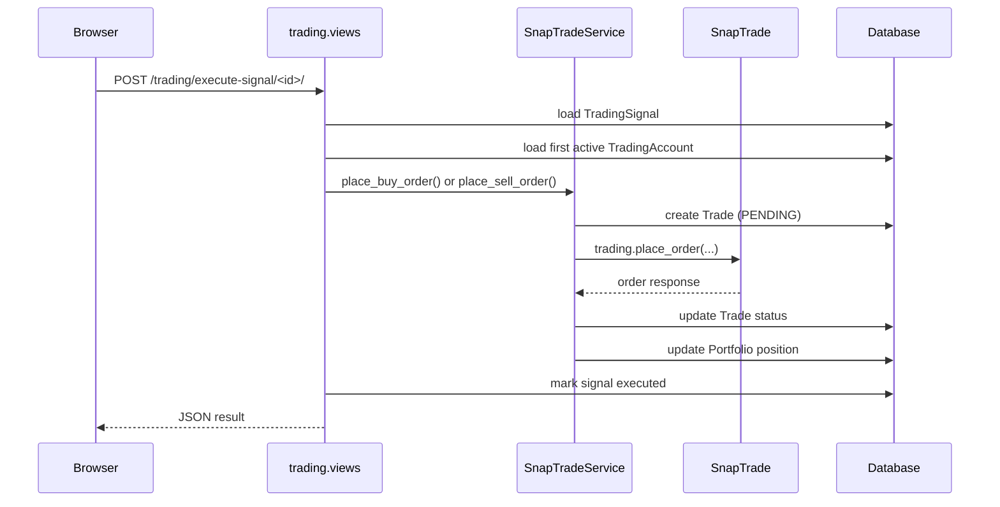

# Project 2 - Index Trend Trading System Architecture

This document explains how `project2` works: the Django apps, models, services, web views,
and external integrations. It is the second of three project architecture notes and is
intended to support the future merge into a unified system.

Unless noted otherwise, file paths in this document are relative to the `project2/`
directory.

## 30-second summary

Project 2 is a Django app implementing a **50/200 moving-average crossover** strategy on
index ETFs:

- Indices: S&P 500, NASDAQ-100, Dow Jones, Russell 2000.
- Tradeable ETFs: SPY, QQQ, DIA, IWM.
- Buy on a **golden cross** (50-day MA crosses above 200-day MA).
- Sell on a **death cross** (50-day MA crosses below 200-day MA).

It has two Django apps:

- `market_data` owns indices, ETFs, price history, moving averages, signals, and the data
  pipeline.
- `trading` owns SnapTrade accounts, trades, portfolio positions, and execution.

There is no Celery or background scheduler; workflows are triggered by dashboard buttons
and one setup command.

```text
Browser (templates + axios)
        |
        +--> market_data.views --> market_data services --> Massive API
        |                         --> Index / ETF / MarketData / MovingAverage / TradingSignal
        |
        +--> trading.views -------> SnapTradeService --> SnapTrade API
                                  --> TradingAccount / Trade / Portfolio
```

## 1. System context



| Actor / system | Role |
| --- | --- |
| Trader | Uses dashboards to fetch data, calculate MAs, detect signals, and execute trades. |
| Django admin | Configures indices, ETFs, trading accounts, and inspects trades. |
| Massive | Supplies historical index aggregates. |
| SnapTrade | Connects broker accounts and places ETF orders. |
| SQLite | Stores all project state (development default). |

## 2. Component and layer map



### Layer responsibilities

| Layer | Files | Responsibility |
| --- | --- | --- |
| Project shell | `index_trading/settings.py`, `urls.py`, `wsgi.py`, `asgi.py` | Configuration, root URL routing. |
| Market data models | `market_data/models.py` | Indices, ETFs, OHLC data, moving averages, signals. |
| Market data services | `market_data/services.py` | Massive fetch, MA calculation, crossover detection. |
| Market data web | `market_data/views.py`, `market_data/urls.py`, templates | Dashboard, index detail, data actions, signal list. |
| Trading models | `trading/models.py` | SnapTrade accounts, trades, portfolio positions. |
| Trading services | `trading/services.py` | SnapTrade order placement, portfolio sync, account info. |
| Trading web | `trading/views.py`, `trading/urls.py`, templates | Trading dashboard, trade list, portfolio, execution, sync. |
| CLI | `market_data/management/commands/setup_indices.py` | Seeds the default index/ETF mappings. |

## 3. Data model



### Model guide

| Model | File | Purpose |
| --- | --- | --- |
| `Index` | `market_data/models.py:5` | Index name and Massive ticker (`I:SPX`, `I:NDX`, etc.). |
| `ETF` | `market_data/models.py:14` | One-to-one ETF mapped to an index. |
| `MarketData` | `market_data/models.py:23` | Daily OHLCV for an index. |
| `MovingAverage` | `market_data/models.py:41` | Daily 50-day and 200-day MA values. |
| `TradingSignal` | `market_data/models.py:56` | Golden/death cross signal with MA and close values. |
| `TradingAccount` | `trading/models.py:6` | SnapTrade account metadata. |
| `Trade` | `trading/models.py:16` | ETF order record with optional signal link. |
| `Portfolio` | `trading/models.py:47` | Current ETF quantity and average cost per account. |

Important relationships:

- `ETF.index` is a one-to-one link to `Index`.
- `TradingSignal` references both the source `Index` and the tradeable `ETF`.
- `Trade.signal` optionally links an order back to the signal that triggered it.
- `Portfolio` is a simple `(account, etf)` position table, not a full portfolio with cash.

## 4. End-to-end flows

### 4.1 Seed indices and ETFs

`manage.py setup_indices` runs `market_data/management/commands/setup_indices.py` and
upserts the four default index/ETF pairs:

| Index | Massive ticker | ETF |
| --- | --- | --- |
| S&P 500 | `I:SPX` | SPY |
| NASDAQ-100 | `I:NDX` | QQQ |
| Dow Jones Industrial | `I:DJI` | DIA |
| Russell 2000 | `I:RUT` | IWM |

### 4.2 Fetch market data

1. Dashboard button calls `market_data.views.fetch_data` (`market_data/views.py:64`).
2. `MassiveAPIService.fetch_all_indices_data()` (`market_data/services.py:50`) loops over
   all `Index` rows.
3. `fetch_index_data()` (`market_data/services.py:13`) calls Massive `list_aggs` and
   upserts `MarketData` rows with `get_or_create`.
4. The view returns a JSON summary and a Django message.



### 4.3 Calculate moving averages

1. Dashboard button calls `market_data.views.calculate_ma` (`market_data/views.py:82`).
2. `MovingAverageService.calculate_all_moving_averages()` (`market_data/services.py:111`)
   loops over indices.
3. `calculate_moving_averages()` (`market_data/services.py:65`) loads `MarketData` into a
   pandas DataFrame, computes 50-day and 200-day rolling means, and upserts
   `MovingAverage` rows when both values exist.

### 4.4 Detect crossovers

1. Dashboard button calls `market_data.views.detect_signals` (`market_data/views.py:100`).
2. `TradingSignalService.detect_all_signals()` (`market_data/services.py:204`) loops over
   indices.
3. `detect_crossovers()` (`market_data/services.py:122`) compares consecutive
   `MovingAverage` rows over the last 30 days:
   - Golden cross: previous `ma_50 <= ma_200` and current `ma_50 > ma_200` -> BUY.
   - Death cross: previous `ma_50 >= ma_200` and current `ma_50 < ma_200` -> SELL.
4. Signals are created only if an identical `(index, signal_type, signal_date)` does not
   already exist.



### 4.5 Execute a signal

1. The signals page or trading dashboard calls `trading.views.execute_signal`
   (`trading/views.py:73`).
2. The view picks the **first active `TradingAccount`** (`trading/views.py:86`).
3. `SnapTradeService.place_buy_order()` (`trading/services.py:21`) or
   `place_sell_order()` (`trading/services.py:91`) creates a `Trade` row and calls
   `SnapTrade.trading.place_order`.
4. On success, the trade is marked EXECUTED and `_update_portfolio()`
   (`trading/services.py:175`) updates the `Portfolio` quantity/average cost.
5. The signal is marked `executed = True`.



### 4.6 Sync portfolio

1. Trading dashboard button calls `trading.views.sync_portfolio`
   (`trading/views.py:117`).
2. `SnapTradeService.sync_all_portfolios()` (`trading/services.py:241`) loops over active
   accounts.
3. `sync_portfolio()` (`trading/services.py:200`) calls
   `get_user_account_positions`, maps returned symbols to `ETF` rows, and updates
   `Portfolio` quantity and average cost.

## 5. Entry point matrix

| Entry point | Trigger | Main code |
| --- | --- | --- |
| Market data dashboard | Browser | `market_data/views.py:10` |
| Index detail | Browser | `market_data/views.py:22` |
| Fetch data | Browser POST | `market_data/views.py:64` |
| Calculate MAs | Browser POST | `market_data/views.py:82` |
| Detect signals | Browser POST | `market_data/views.py:100` |
| Signals list | Browser | `market_data/views.py:118` |
| Trading dashboard | Browser | `trading/views.py:10` |
| Trades list | Browser | `trading/views.py:28` |
| Portfolio view | Browser | `trading/views.py:55` |
| Execute signal | Browser POST | `trading/views.py:73` |
| Sync portfolio | Browser POST | `trading/views.py:117` |
| Seed indices/ETFs | CLI | `market_data/management/commands/setup_indices.py` |
| Admin | Django admin | `market_data/admin.py`, `trading/admin.py` |

## 6. File-by-file map

| File | What it does |
| --- | --- |
| `index_trading/settings.py` | Installs `market_data` and `trading`, configures SQLite and templates; API keys are hardcoded at `:126-129`. |
| `index_trading/urls.py` | Mounts `market_data` at `/` and `trading` at `/trading/`. |
| `market_data/models.py` | `Index`, `ETF`, `MarketData`, `MovingAverage`, `TradingSignal`. |
| `market_data/services.py` | `MassiveAPIService`, `MovingAverageService`, `TradingSignalService`. |
| `market_data/views.py` | Dashboard, index detail, fetch/MA/detect actions, signals list. |
| `market_data/urls.py` | Routes for the market data app. |
| `market_data/management/commands/setup_indices.py` | Seeds default index/ETF mappings. |
| `market_data/admin.py` | Admin for market data models, including a mark-as-executed action. |
| `trading/models.py` | `TradingAccount`, `Trade`, `Portfolio`. |
| `trading/services.py` | `SnapTradeService` for orders, portfolio sync, and account info. |
| `trading/views.py` | Trading dashboard, trades, portfolio, execute signal, sync. |
| `trading/urls.py` | Routes for the trading app. |
| `trading/admin.py` | Admin for accounts, trades, and positions. |
| `templates/base.html` | Shared Bootstrap layout and axios helper `handleAction()`. |
| `market_data/templates/market_data/dashboard.html` | Data pipeline dashboard and action buttons. |
| `market_data/templates/market_data/signals_list.html` | Signal list and per-signal execute button. |
| `trading/templates/trading/dashboard.html` | Trading dashboard, pending signals, positions, trades. |

## 7. Known gaps and risks

1. **No migrations are committed.** Both `migrations/` directories contain only
   `__init__.py`, so a fresh checkout has no tables until `makemigrations` is run.
2. **Three referenced templates are missing:** `market_data/index_detail.html`,
   `trading/trades_list.html`, and `trading/portfolio.html`. Those views will raise
   `TemplateDoesNotExist` when opened.
3. **Wrong SnapTrade import.** `trading/services.py:4` imports
   `from snaptrade_python_sdk import SnapTrade`, but the installed package is
   `snaptrade_client`.
4. **SnapTrade usage is out of date.** The constructor, `place_order`,
   `get_user_account_positions`, response fields, and the `user_secret` strategy do not
   match the current SDK/API. Project 1's `trading/services/snaptrade_client.py` is the
   working reference.
5. **Fake SnapTrade identity.** `get_user_id()` returns `user_<account.id>` and
   `user_secret` is set to `account.account_id` (`trading/services.py:17-19`, `:55`),
   which is not a real SnapTrade user/secret pair.
6. **API keys are hardcoded in settings.** There is no `.env` loading; keys must be edited
   directly in `index_trading/settings.py:126-129`.
7. **No automation.** There is no Celery, cron, or scheduled task; every step is manual.
8. **No rate limiting/retry for Massive.** `MassiveAPIService` calls the API directly and
   only checks for exceptions.
9. **Errors are print-based.** Services print errors and return zero/empty results, making
   failures hard to observe in the web UI.
10. **Signal detection window is short.** `detect_crossovers()` defaults to the last 30
    days, so infrequent runs can miss a cross.
11. **Execution is simplistic.** `execute_signal` always buys 100 shares and uses the
    signal close price as the limit price (`trading/views.py:96`); there is no cash check
    or position sizing.
12. **Hardcoded exchange.** Orders use `"exchange": "NYSE"` (`trading/services.py:41`,
    `:125`), which is not correct for all ETFs.
13. **First account wins.** Execution uses the first active account only
    (`trading/views.py:86`).
14. **No tests.** Both `tests.py` files are placeholders.

## 8. Merge notes for the unified system

Overlap with `project1`:

- Massive market data client (project 1 has a richer, rate-limited client).
- SnapTrade execution and portfolio sync (project 1 has an SDK-based executor).
- `TradingSignal`, `Trade`, and `Portfolio` concepts (project 1 has more complete
  portfolio/cash/trade models).
- Dashboard patterns and Bootstrap templates.

Likely merge direction:

- Keep project 1's `trading/services/massive_client.py` and
  `trading/services/snaptrade_client.py`; replace project 2's raw implementations.
- Represent `Index` and `ETF` as reference data alongside project 1's `Stock`, or add them
  as new models in the unified `trading` app.
- Keep `MovingAverage` as an indicator model; it does not exist in project 1.
- Make the 50/200 MA crossover a pluggable strategy (like project 1's momentum strategy)
  rather than a separate app.
- Unify `TradingSignal` and `Trade` with project 1's models, adding a `strategy` field to
  distinguish momentum from trend signals.
- Move manual button workflows into project 1's command/Celery infrastructure where
  automation is desired.
- Migrate the UI into project 1's dashboard as an "Index Trend" strategy page.

## 9. Glossary

| Term | Meaning |
| --- | --- |
| Golden cross | 50-day MA crossing above the 200-day MA; treated as a BUY signal. |
| Death cross | 50-day MA crossing below the 200-day MA; treated as a SELL signal. |
| Index ticker | Massive symbol such as `I:SPX`; not directly tradeable. |
| ETF ticker | Tradeable proxy such as SPY; stored in `ETF.ticker`. |
| MA | Moving average; 50-day and 200-day windows are used here. |
