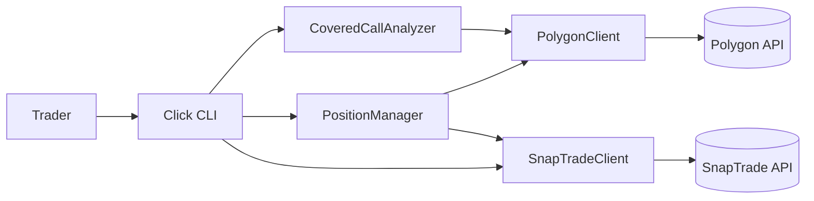
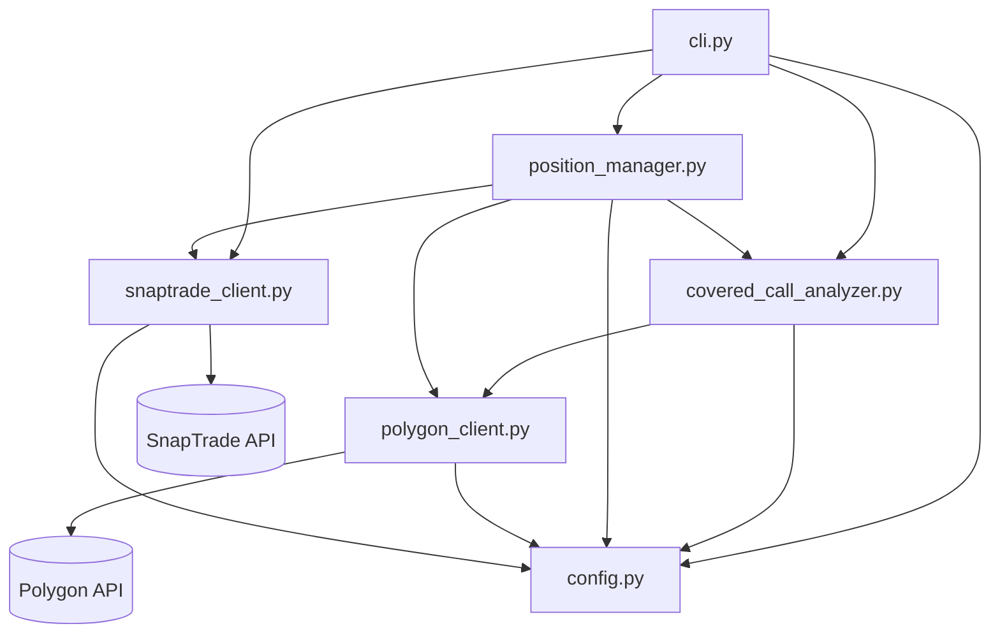
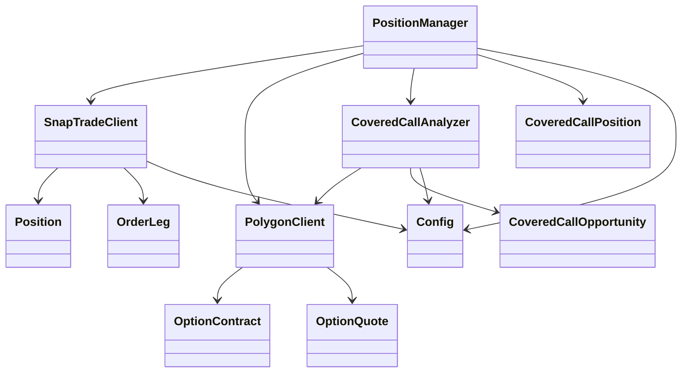
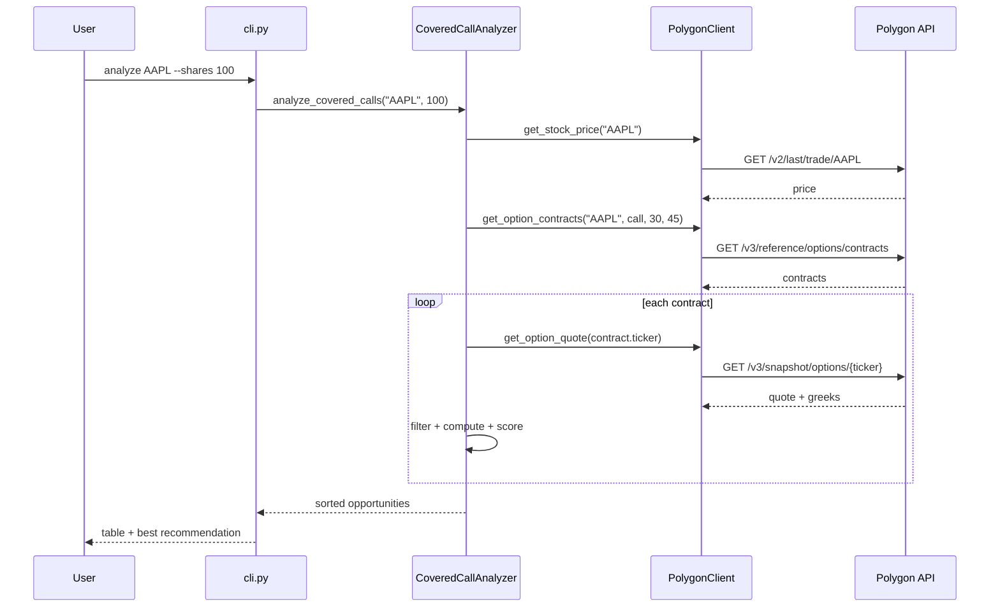
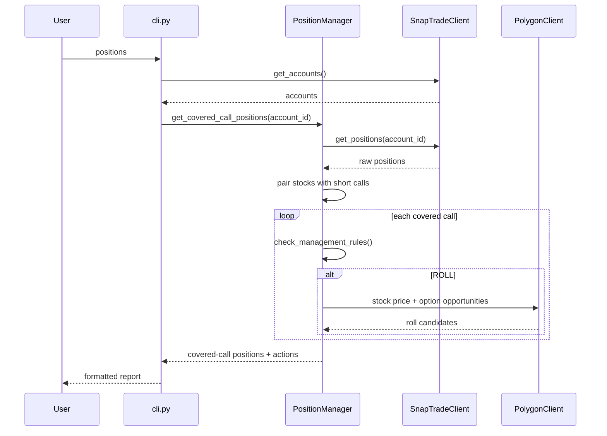

# Project 3 - Covered Call Trading CLI Architecture

This document explains how `project3` works: the Click CLI, the Polygon options client,
the covered-call analyzer, the position manager, and the SnapTrade execution client. It is
the third of three project architecture notes and is intended to support the future merge
into a unified system.

Unless noted otherwise, file paths in this document are relative to the `project3/`
directory.

## 30-second summary

Project 3 is a **standalone Python CLI** (not Django) that finds and optionally executes
covered-call trades:

- Buy/hold 100 shares of a stock.
- Sell call options against those shares to collect premium.
- Target 15-30 delta, 30-45 days to expiration.
- Close at 50 percent profit or roll at 21 DTE.
- Use Polygon for option contracts, quotes, and greeks.
- Use SnapTrade for account positions and multi-leg option orders.

There is no database. Every command fetches live data, computes results, and prints a
report.

```text
Click CLI
   |
   +--> CoveredCallAnalyzer --> PolygonClient --> Polygon API
   |
   +--> PositionManager -----> SnapTradeClient --> SnapTrade API
   |                     \----> PolygonClient
   |
   \--> SnapTradeClient ------> SnapTrade API
```

## 1. System context



| Actor / system | Role |
| --- | --- |
| Trader | Runs `analyze`, `trade`, `positions`, and `setup` commands. |
| Polygon | Supplies stock prices, option contracts, option snapshots, greeks, volume, and open interest. |
| SnapTrade | Supplies brokerage positions and accepts option orders. |
| `.env` | Stores API keys and SnapTrade user credentials. |

## 2. Component and layer map



### Module responsibilities

| Module | Responsibility |
| --- | --- |
| `cli.py` | Click command definitions, input prompts, table/format output, `.env` setup helper. |
| `config.py` | Environment-backed credentials, API base URLs, covered-call rule constants. |
| `polygon_client.py` | REST wrapper for Polygon stock/options endpoints; contract and quote data classes. |
| `covered_call_analyzer.py` | Builds covered-call opportunities, filters by delta/DTE, computes returns and scores. |
| `position_manager.py` | Reads broker positions, identifies covered calls, checks profit/roll rules, suggests rolls. |
| `snaptrade_client.py` | REST wrapper for SnapTrade accounts, positions, and multi-leg option orders. |

## 3. Domain objects



| Object | File | Purpose |
| --- | --- | --- |
| `Config` | `config.py:4` | Credentials, base URLs, and strategy rules. |
| `OptionContract` | `polygon_client.py:9` | Option ticker, type, strike, expiration, underlying. |
| `OptionQuote` | `polygon_client.py:17` | Bid/ask/mid, greeks, IV, open interest, volume. |
| `CoveredCallOpportunity` | `covered_call_analyzer.py:10` | One scored candidate with return/risk metrics. |
| `Position` | `snaptrade_client.py:8` | Broker position: symbol, quantity, prices, P&L. |
| `OrderLeg` | `snaptrade_client.py:16` | One leg of an option order: action, symbol, quantity. |
| `CoveredCallPosition` | `position_manager.py:11` | A stock position paired with short calls. |

## 4. Strategy rules

Defined in `config.py:14`:

| Rule | Default | Meaning |
| --- | --- | --- |
| `min_delta` | 0.15 | Minimum absolute call delta. |
| `max_delta` | 0.30 | Maximum absolute call delta. |
| `min_dte` | 30 | Minimum days to expiration. |
| `max_dte` | 45 | Maximum days to expiration. |
| `profit_target` | 0.50 | Close when 50 percent of premium is captured. |
| `roll_dte` | 21 | Roll when 21 DTE is reached. |

## 5. End-to-end flows

### 5.1 Analyze covered-call opportunities

1. `python cli.py analyze TICKER [--shares N] [--limit N]` calls `analyze()`
   (`cli.py:24`).
2. `CoveredCallAnalyzer.analyze_covered_calls()` (`covered_call_analyzer.py:98`):
   - Fetches the stock price via `PolygonClient.get_stock_price()`
     (`polygon_client.py:52`).
   - Fetches call contracts in the DTE window via `get_option_contracts()`
     (`polygon_client.py:64`).
   - Fetches each contract snapshot via `get_option_quote()`
     (`polygon_client.py:98`).
   - Filters out zero bid/ask and deltas outside the rule range.
   - Computes DTE, moneyness, annualized return, return if assigned, breakeven, max profit,
     max loss, and probability of profit.
   - Scores each opportunity with the weighted formula in `_score_opportunity()`
     (`covered_call_analyzer.py:53`).
   - Sorts by score descending.
3. `cli.py` prints the top opportunities and the best recommendation.



### 5.2 Execute a covered call

1. `python cli.py trade TICKER [--execute]` calls `trade()` (`cli.py:59`).
2. `CoveredCallAnalyzer.get_best_covered_call()` (`covered_call_analyzer.py:165`) returns
   the highest-scoring opportunity.
3. Without `--execute`, the CLI only displays the recommendation.
4. With `--execute`, the CLI:
   - Creates `SnapTradeClient` (`snaptrade_client.py:22`).
   - Fetches accounts via `get_accounts()` (`snaptrade_client.py:56`).
   - Uses the first account.
   - Calls `sell_covered_call()` (`snaptrade_client.py:108`), which builds a SELL
     `OrderLeg` and calls `place_multileg_order()` (`snaptrade_client.py:81`).
5. The CLI prints success or failure.

### 5.3 View and manage covered-call positions

1. `python cli.py positions [--account-id ID]` calls `positions()` (`cli.py:109`).
2. If no account id is given, `SnapTradeClient.get_accounts()` is called and the first
   account is used.
3. `PositionManager.get_covered_call_positions()` (`position_manager.py:30`):
   - Fetches all broker positions via `SnapTradeClient.get_positions()`
     (`snaptrade_client.py:60`).
   - Classifies positions as stock or option using symbol inspection.
   - Pairs stock positions with short call positions on the same underlying.
   - Builds `CoveredCallPosition` objects with strike, expiration, entry/current premium,
     DTE, and P&L.
4. For each position, `check_management_rules()` (`position_manager.py:76`) returns:
   - `CLOSE` when profit target is reached.
   - `ROLL` when DTE is at or below the roll threshold.
   - `HOLD` otherwise.
5. For roll candidates, `suggest_roll_options()` (`position_manager.py:87`) re-runs the
   analyzer and filters for strikes at or above the current strike when the stock is above
   the strike.



### 5.4 Configure credentials

`python cli.py setup` (`cli.py:153`) copies `.env.example` into `.env` after prompting for:

- `POLYGON_API_KEY`
- `SNAPTRADE_CONSUMER_KEY`
- `SNAPTRADE_CLIENT_ID`
- `SNAPTRADE_USER_ID`
- `SNAPTRADE_USER_SECRET`

## 6. Entry point matrix

| Command | Trigger | Main code |
| --- | --- | --- |
| `analyze` | CLI | `cli.py:24` -> `covered_call_analyzer.py:98` |
| `trade` | CLI | `cli.py:59` -> `snaptrade_client.py:108` |
| `positions` | CLI | `cli.py:109` -> `position_manager.py:30` |
| `setup` | CLI | `cli.py:153` |
| Option data fetch | Internal | `polygon_client.py:52`, `:64`, `:98` |
| Multi-leg order | Internal | `snaptrade_client.py:81` |
| Close/roll helpers | Internal | `position_manager.py:105`, `:117` |

There are no Django views, URLs, tasks, or database models in this project.

## 7. File-by-file map

| File | What it does |
| --- | --- |
| `cli.py` | Click command group and commands; loads `.env`, formats output, handles prompts. |
| `config.py` | Reads environment variables and defines strategy rules and API base URLs. |
| `polygon_client.py` | Polygon REST wrapper: stock price, option contracts, option quotes, options chain. |
| `covered_call_analyzer.py` | Filters contracts, computes return/risk metrics, scores and ranks opportunities. |
| `position_manager.py` | Reads broker positions, identifies covered calls, evaluates close/roll rules. |
| `snaptrade_client.py` | SnapTrade REST wrapper for accounts, positions, and multi-leg option orders. |
| `.env.example` | Template for required credentials. |
| `requirements.txt` | `requests`, `click`, `python-dotenv`, `tabulate`, `colorama`. |
| `README.md` | User-facing usage guide and strategy overview. |

## 8. Known gaps and risks

1. **`.env` is loaded too late.** `cli.py` imports `covered_call_analyzer` and
   `snaptrade_client` at lines 9-11, but calls `load_dotenv()` at line 17. `Config` reads
   `os.getenv()` when `config.py` is imported (`config.py:5-9`), so `.env` values are not
   visible unless variables are already exported in the shell.
2. **SnapTrade client is not using the current API.** It calls a raw REST base URL
   `https://api.snaptrade.com/api/v1` with Basic Auth `(consumer_key, user_secret)` and a
   `ClientID` header (`snaptrade_client.py:28`, `:36-41`). Current SnapTrade requests are
   signed and the endpoints/payloads differ.
3. **Old endpoints and response assumptions.** `/accounts/{user_id}`,
   `/accounts/{account_id}/positions`, and `/trade/place-multileg-order` do not match the
   current SnapTrade API. The code also assumes a top-level `success` field from order
   responses.
4. **Position parsing is fragile.** Option detection uses `"C" in symbol` / `"P" in
   symbol`, which can misclassify stock tickers. Underlying extraction uses
   `^([A-Z]+)`, which fails for symbols containing digits or punctuation.
5. **OCC symbol parsing assumptions.** Strike parsing uses the last 8 digits and divides by
   1000; expiration parsing assumes a 6-digit `YYMMDD` block. Non-standard or adjusted
   option symbols may break.
6. **`shares_owned` is unused by the analyzer.** It is accepted in
   `analyze_covered_calls()` but never used to cap contracts or verify sufficient shares.
7. **No persistence.** There is no database or trade history; every command pulls live
   data.
8. **No rate limiting/retry.** Polygon free-tier limits and transient failures are not
   handled beyond raising exceptions.
9. **First account wins.** `trade` and `positions` use the first SnapTrade account when no
   account is specified (`cli.py:88`, `cli.py:123`).
10. **No logging.** The code uses `print`/`click.echo` only.
11. **No tests.** There is no test directory or test suite.
12. **Absolute imports.** Modules import each other as top-level modules
    (`from config import Config`, `from snaptrade_client import SnapTradeClient`), so the
    CLI must be run from inside `project3/`; it cannot be run as a package module without
    changes.
13. **Simplified risk math.** `max_loss`, `breakeven`, and `max_profit` are approximations
    that do not account for the full 100-share multiplier, assignment, or fees.
14. **Close/roll helpers are not exposed as CLI commands.** `close_position()` and
    `roll_position()` exist in `position_manager.py` but no command calls them.
15. **Credentials are stored in plain `.env`.** The SnapTrade user secret is sensitive and
    is written as plain text.

## 9. Merge notes for the unified system

Project 3 is conceptually different from projects 1 and 2: it is an **options income
strategy**, not an equity momentum/trend strategy. The merge should preserve that
distinction rather than forcing it into the existing equity flow.

Likely merge direction:

- Keep the covered-call analyzer and scoring logic as a dedicated strategy module.
- Replace the raw `SnapTradeClient` with project 1's SDK-based `TradingExecutor`, extended
  with multi-leg options support.
- Add options-aware models:
  - Option contract/reference data (strike, expiration, type, multiplier).
  - Option positions (contract symbol, quantity, strike, expiration, premium).
  - Covered-call position view that pairs stock and short-call legs.
  - Option order/trade records with leg details.
- Reuse project 1's `Portfolio`/`Trade` concepts, but add an instrument type (`EQUITY`,
  `OPTION`) and option-specific fields.
- Keep Polygon as an options data provider alongside Massive (equities). Normalize both
  behind a market-data interface.
- Convert CLI commands into Django management commands or web views, or keep the CLI as a
  thin client over the unified service layer.
- Move strategy rules into Django settings or a strategy configuration model.
- Reuse project 1's Celery infrastructure for scheduled position monitoring
  (profit target, roll DTE alerts).
- Watch for naming collisions: project 3's `Position` and `SnapTradeClient` should not
  shadow project 1's `Position` and `TradingExecutor`.

## 10. Glossary

| Term | Meaning |
| --- | --- |
| Covered call | Long 100 shares plus one short call against those shares. |
| Delta | Option price sensitivity to the underlying; used here as a probability proxy. |
| DTE | Days to expiration. |
| Premium | Option price received when selling a call. |
| Assignment | The buyer exercises the call and the seller must deliver shares. |
| Roll | Close the current call and sell a later or different-strike call. |
| OCC symbol | Standard option identifier encoding root, expiration, type, and strike. |
| Multi-leg order | An order containing more than one option leg, used for rolls. |
